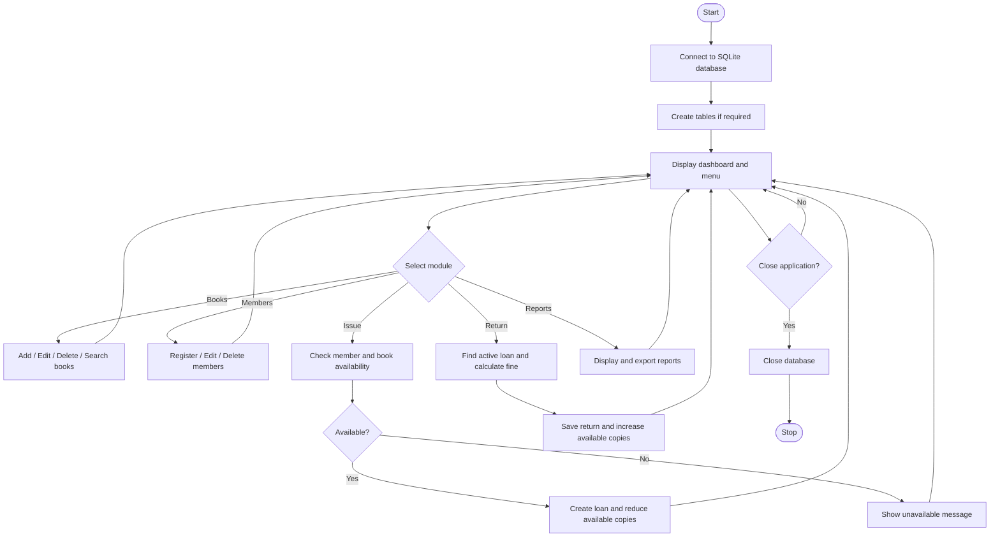

# Algorithm and Flowchart

## Algorithm
1. Start.
2. Connect to SQLite and create Books, Members, and Loans tables if absent.
3. Display the dashboard and navigation options.
4. Accept the user's selected module.
5. For Books: add, edit, delete, or search book records.
6. For Members: register, edit, or delete member records.
7. For Issue: validate member and available book, create loan, reduce available copies.
8. For Return: find active loan, calculate overdue fine, record return, increase available copies.
9. For Reports: display summaries and export CSV data.
10. Refresh the interface after each operation.
11. On close, close the database connection.
12. Stop.

## Flowchart

